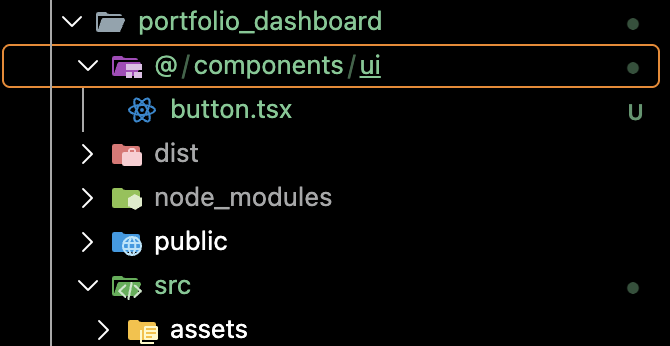

# README

## Runtime

- NodeJs: v24.14.1
- NPM

## Tech Stack

- React
- Typescript

## Dependencies

- Tailwind - CSS
- Lucid react - Icon
- Shadcn - Reusable components
- Recharts
- tabler/icons-react

## Setup and Install

### Node

```sh
node -v
```

```sh
npm -v
```

### React

```sh
npm create vite@latest ./portfolio_dashboard -- --template react-ts
```

### Lucide React

```sh
cd ./portfolio_dashboard && npm install lucide-react
```

### Tailwind

[Tailwind Installation Guide](https://tailwindcss.com/docs/installation/using-vite)

```sh
npm install tailwindcss @tailwindcss/vite
```

**Configure Tailwind:**

```ts
import { defineConfig } from 'vite'
import tailwindcss from '@tailwindcss/vite'

export default defineConfig({
  plugins: [
    tailwindcss(),
  ],
})
```

**tsconfig.json:** Add compiler option

```ts

  "compilerOptions": {
    "baseUrl": ".",
    "paths": {
      "@/*": ["./src/*"]
    }
  }
```

**vite.config.ts:**

```ts
import path from "path"

...
  resolve: {
    alias: {
      "@": path.resolve(__dirname, "./src"),
    },
  },
```

### shadcn

[shadcn](https://ui.shadcn.com/docs/installation/vite)

```sh
npx shadcn@latest init
```

**Adding a component:**

```sh
npx shadcn@latest add button

npx shadcn@latest add sidebar-01
```

### Recharts

```sh
npm install recharts
```

## Run React

```sh
cd frontend/v1 && npm run dev
```

## Troubleshooting

Error after executing

```sh
npm create vite@latest ./portfolio-dashboard -- --template react-ts
```

```txt
│
◇  Installing dependencies with npm...
npm error code ERESOLVE
npm error ERESOLVE unable to resolve dependency tree
npm error
npm error While resolving: portfolio-dashboard@0.0.0
npm error Found: typescript@7.0.2
npm error node_modules/typescript
npm error   dev typescript@"~7.0.2" from the root project
npm error
npm error Could not resolve dependency:
npm error peer typescript@">=4.8.4 <6.1.0" from typescript-eslint@8.72.1
npm error node_modules/typescript-eslint
npm error   dev typescript-eslint@"^8.72.0" from the root project
npm error
npm error Fix the upstream dependency conflict, or retry this command with --force or --legacy-peer-deps to accept an incorrect (and potentially broken) dependency resolution.
npm error
npm error
npm error For a full report see:
npm error /Users/kunmi/.npm/_logs/2026-10-27T20_05_12_442Z-eresolve-report.txt
npm error A complete log of this run can be found in: /Users/kunmi/.npm/_logs/2026-10-27T20_05_12_442Z-debug-0.log
npm error code 1
npm error path /Users/kunmi/workspace/projects/engineering/repository/portfolio-platform/portfolio/frontend
npm error command failed
npm error command sh -c 'cva' ./portfolio-dashboard --template react-ts
npm error A complete log of this run can be found in: /Users/kunmi/.npm/_logs/2026-10-27T20_05_07_366Z-debug-0.log
```

### Fix

- Downgrade typescript

**Edit:** `package.json`

from `"typescript": "~7.0.2"` to `"typescript": "~5.9.3"`

## ShadCN Creates new @ folder when adding new components

```sh
npx shadcn@latest add button
```



```sh
npx shadcn@latest info
```

### Fix

Add the baseUrl and paths properties to the compilerOptions section of tsconfig.json and tsconfig.app.json:

## Section Card flex col to 1 on small screen

Screen size Columns
Mobile (below 640px) 1
Small screens (sm, 640px+) 2
Large screens (lg, 1024px+) 4

**from:**

```jsx

    <div className="grid grid-cols-4 gap-4 px-4 *:data-[slot=card]:bg-gradient-to-t *:data-[slot=card]:from-primary/5 *:data-[slot=card]:to-card *:data-[slot=card]:shadow-xs lg:px-1 @xl/main:grid-cols-2 @m/main:grid-cols-1 @5xl/main:grid-cols-4 dark:*:data-[slot=card]:bg-card">
```

```jsx
<div className="grid grid-cols-1 gap-4 px-4 *:data-[slot=card]:bg-gradient-to-t *:data-[slot=card]:from-primary/5 *:data-[slot=card]:to-card *:data-[slot=card]:shadow-xs sm:grid-cols-2 lg:px-1 lg:grid-cols-4 dark:*:data-[slot=card]:bg-card">
```
